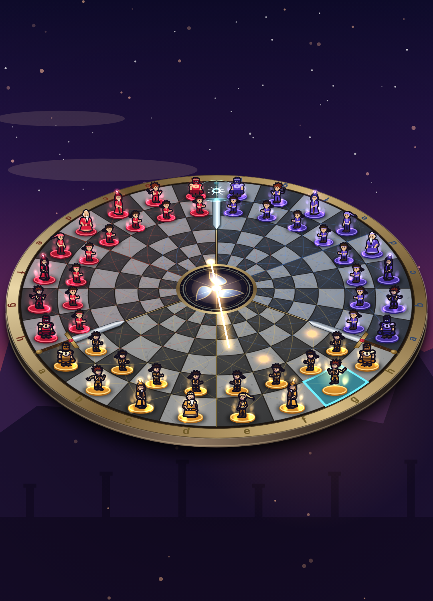

# Règles officielles — Chess Trio Warriors

Ce document est la référence des règles du jeu. Elles reprennent celles du jeu physique
« Chess for 3 » à plateau **rond**. Le moteur `engine/` en est l'implémentation exacte (source
de vérité côté serveur). Les points où une règle a dû être précisée sont signalés par
**[Convention]**.

Toutes les règles traditionnelles des échecs s'appliquent, sauf mention contraire : marche des
pièces, roque, prise en passant, promotion, interdiction de laisser son roi en échec, règle
des 50 coups, triple répétition.

## 1. Équipes et ordre de jeu

- Trois équipes : **0 = Blanc**, **1 = Gris**, **2 = Noir** (dans l'application, les couleurs
  des guerriers sont respectivement **or**, **cramoisi** et **violet**).
- Blanc joue en premier, puis le jeu tourne dans le **sens des aiguilles d'une montre** :
  Blanc → Gris → Noir → Blanc… Les équipes éliminées sont sautées.

## 2. Le plateau

### 2.1 Forme

- Un disque de **144 cases** : **24 colonnes** radiales (secteurs de 15°) × **6 anneaux**
  concentriques. L'**anneau 1** est l'anneau extérieur, l'**anneau 6** borde le centre.
- Au centre, un **médaillon** (≈ 20 % du rayon) : il se **traverse** mais ce n'est **pas une
  case** (aucune pièce ne peut s'y arrêter).
- Chaque équipe possède **8 colonnes consécutives** (un arc de 120°), nommées `a` à `h` de sa
  gauche vers sa droite (sens trigonométrique, vu du dessus). Blanc est en bas, Gris en haut à
  gauche, Noir en haut à droite.
- Notation d'une case : `<équipe><colonne><anneau>`, par exemple `0d1` (Blanc, colonne d,
  anneau 1) ou `2h6`.
- Couleur des cases : (colonne + anneau) pair → case **claire**, impair → case **foncée**.
  La case de coin `h1` de chaque équipe est claire. Les colonnes `c` et `c + 12`
  (diamétralement opposées) ont la même couleur au même anneau.
- Des **lignes de trajet diagonales** colorées discrètes sont tracées sur le plateau (aide
  visuelle pour les fous).

### 2.2 Les épées

Les trois lignes radiales qui séparent deux équipes portent chacune une **épée** :

- la **poignée** est sur l'**anneau 1** ;
- la **lame** couvre les **anneaux 2 et 3**.

Un pas « franchit une frontière » quand il relie deux colonnes voisines appartenant à deux
équipes différentes. Il franchit la **poignée** si l'une de ses extrémités est sur
l'anneau 1, la **lame** si son extrémité la plus extérieure est sur l'anneau 2 ou 3. Au-delà
(anneaux 4 à 6), la frontière ne gêne rien.

## 3. Position initiale

Pour chaque équipe, sur ses 8 colonnes :

- **Anneau 1** (de `a` à `h`) : **Tour, Cavalier, Fou, Roi, Dame, Fou, Cavalier, Tour** ;
- **Anneau 2** : 8 pions.

**[Convention]** Le roi est placé en `d1` et la dame en `e1` : avec la couleur de case
ci-dessus, `d1` est une case **claire**, ce qui place chaque roi sur une case blanche comme
sur le plateau physique. La disposition est identique (par rotation) pour les trois équipes.

## 4. Déplacements

Trois sortes de pas élémentaires :

- **Vertical** : le long de la colonne, vers le centre ou vers l'extérieur. Vers le centre
  depuis l'anneau 6, on **traverse le médaillon** : depuis `(c, anneau 6)` on arrive en
  `(c + 12, anneau 6)`, puis on continue **vers l'extérieur** sur la colonne `c + 12`. On
  arrive sur la même couleur de case (c'est voulu).
- **Horizontal** : on pivote autour du centre en restant sur le même anneau. L'anneau est
  circulaire : il boucle sur ses 24 cases.
- **Diagonal** : anneau ± 1 **et** colonne ± 1, en restant sur la même ligne de trajet. Depuis
  chaque case partent 2 diagonales vers le centre et 2 vers l'extérieur. Une diagonale peut
  traverser le centre en suivant la même ligne ; elle s'arrête au bord extérieur (pas de
  rebond sur le cercle extérieur).

**[Convention] Diagonale à travers le centre** : une diagonale qui entre dans le médaillon
depuis `(c, anneau 6)` avec le sens angulaire `s` (± 1) en ressort en `(c + 12 + 2s, anneau 6)`,
puis continue vers l'extérieur avec le **même sens** `s`. La traversée compte comme une case
virtuelle ; la parité est préservée, si bien que **le fou garde toujours sa couleur**.

Une pièce à longue portée ne peut jamais revenir sur sa propre case (une horizontale complète
s'arrête après 23 cases ; une diagonale qui ferait le tour s'arrête avant sa case de départ).

| Pièce | Marche |
|-------|--------|
| **Roi** | 1 pas dans n'importe quelle direction (vertical, horizontal, diagonal), y compris à travers le centre. |
| **Dame** | Tour + Fou. |
| **Tour** | Verticales (à travers le centre) et horizontales (circulaires). |
| **Fou** | Diagonales (à travers le centre, en gardant sa couleur). |
| **Cavalier** | 2 pas verticaux puis 1 pas horizontal, **ou** 1 pas horizontal puis 2 pas verticaux. Il saute par-dessus les pièces et peut traverser le centre. |
| **Pion** | voir §5. |

**[Convention] Cavalier** : on ne retient que ces deux formes (pas de « 2 horizontaux +
1 vertical »), conformément aux règles du jeu physique. Les deux ordres donnent en général
la même case ; près du centre ils peuvent mener à des cases différentes (toutes sont
permises). Les destinations identiques sont fusionnées.

Les pièces à longue portée s'arrêtent à la première pièce rencontrée (qu'elles peuvent
prendre si elle est adverse, voir les épées). Le médaillon n'arrête rien.

## 5. Les pions

- Un pion avance d'**une case vers le centre** (anneau croissant). Depuis l'anneau 2, il peut
  avancer de **deux cases** si les deux sont libres.
- Il **traverse le centre** comme un pas vertical : depuis `(c, 6)` il arrive en `(c + 12, 6)`.
  Il a alors « traversé » et avance désormais **vers l'extérieur** sur la colonne opposée.
- Il **prend en diagonale vers l'avant** (vers le centre avant la traversée, vers l'extérieur
  après), y compris à travers le centre (`(c, 6)` → `(c + 12 ± 2, 6)`).
- **Prise en passant** : après une avance de deux cases, la case sautée peut être prise
  « en passant » par un pion adverse qui aurait pu prendre sur cette case.
  **[Convention]** Chacun des deux adversaires peut le faire à son premier tour qui suit ;
  le droit expire quand l'équipe du pion rejoue (ou passe son tour).
- **Promotion** : un pion qui a traversé le centre et atteint l'**anneau 1** est promu, **au
  choix**, en dame, tour, fou ou cavalier. Les coups automatiques (fin du minuteur) et les bots
  choisissent la dame.

## 6. Les épées

### 6.1 Poignées

- Une poignée **fermée** interdit à toute pièce de la traverser par un pas **horizontal** ou
  **diagonal** (tout pas qui franchit la frontière avec une extrémité sur l'anneau 1, y compris
  le pas horizontal du cavalier). Le coup est illégal.
- **[Convention] Cavalier** : un saut dont l'une des deux décompositions (verticale puis
  horizontale, ou l'inverse) fait son pas horizontal à travers une poignée est considéré
  comme franchissant cette poignée.
- Une poignée **s'ouvre définitivement** quand :
  1. une équipe adjacente est **éliminée** (ses 2 poignées s'ouvrent) ;
  2. une équipe encore en jeu n'a **plus aucune de ses pièces** sur ses propres cases de
     l'anneau 1 (ses arrières) : ses 2 poignées s'ouvrent. Y replacer ensuite des pièces ne
     les referme pas.
- Même **ouverte**, une poignée ne permet que de **passer** : un coup qui la traverse ne peut
  **ni prendre, ni donner échec** (une pièce ne contrôle aucune case au-delà d'une poignée).

### 6.2 Lames

Les lames ne concernent que les **pions qui n'ont pas encore traversé le centre** : ils ne
peuvent ni avancer ni prendre en franchissant une lame. Ils doivent atteindre l'**anneau 4**
(« la fin du cours d'eau ») pour pouvoir prendre de l'autre côté (prise de l'anneau 4 vers
l'anneau 5). Un pion qui a traversé le centre ignore les lames (mais pas les poignées).

## 7. Échec, mat, roi emprisonné, pat

- Un roi est **en échec** s'il est attaqué par une pièce d'une équipe adverse encore en jeu.
  On ne peut jamais jouer un coup qui laisse son propre roi en échec.
- **Mat** : une équipe n'est mate **qu'à son tour** : si elle est en échec et n'a aucun coup
  légal. Le mat est crédité à l'équipe qui attaque le roi ; si plusieurs l'attaquent, à celle
  qui a joué le plus récemment.
- **Roi emprisonné** : si un roi est en échec alors que ce n'est **pas** le tour de son équipe
  (par exemple parce qu'un coup d'une autre équipe a dégagé une ligne), l'équipe au trait
  **peut capturer ce roi** (c'est un coup légal, facultatif). L'équipe du roi capturé est
  alors **mate**, au crédit de l'équipe qui a capturé.
- **Pat** : une équipe qui n'a aucun coup légal sans être en échec **passe son tour**.
- **Personne ne peut jouer** : si toutes les équipes encore en jeu passent à la suite :
  - à **3 équipes**, l'équipe au trait (la première à avoir passé) **perd**.
    **[Convention]** Elle est traitée comme matée au profit de la dernière équipe à avoir
    joué : en mode `firstMate` la partie s'arrête (raison `blockade`), en mode `twoMates`
    l'équipe est éliminée et la partie continue (si plus personne ne peut jouer à 2 : nulle) ;
  - à **2 équipes**, la partie est **nulle**.

## 8. Équipes éliminées (fossiles)

Une équipe matée ou qui abandonne est éliminée. Ses pièces restent sur le plateau comme des
**fossiles** gelés : elles ne bougent plus, ne donnent plus échec, **bloquent** les lignes,
mais **peuvent être prises** (un roi fossile aussi). L'élimination ouvre les 2 poignées de
l'équipe.

## 9. Modes de jeu et fin de partie

- **`twoMates`** (règles officielles) : la partie continue jusqu'à ce qu'il ne reste qu'**une**
  équipe, qui gagne.
- **`firstMate`** : le **premier mat** (ou roi emprisonné capturé) termine la partie ; le
  vainqueur est l'équipe créditée du mat.
- **Abandon** (ou départ) : l'équipe est éliminée sans crédit.
- **Nulles** :
  - **50 coups** : 50 tours complets sans prise ni mouvement de pion, soit 50 × (nombre
    d'équipes en jeu) tours individuels consécutifs (un tour passé compte) ;
  - **triple répétition** : la même position (pièces, équipe au trait, équipes en jeu,
    droits de roque, poignées, prises en passant) pour la troisième fois ;
  - plus personne ne peut jouer à 2 équipes (§7).

## 10. Roque

Le roi et une tour qui n'ont pas bougé, cases intermédiaires libres, roi ni en échec ni sur une
case de passage attaquée :

- **petit roque** (côté `a`, `castle: 'king'`) : roi `d1 → b1`, tour `a1 → c1` ;
- **grand roque** (côté `h`, `castle: 'queen'`) : roi `d1 → f1`, tour `h1 → e1`
  (`e1`, `f1`, `g1` libres ; `e1` et `f1` non attaquées).

## 11. Interface du moteur (`engine/src/index.ts`)

État immuable, entièrement sérialisable en JSON (`GameState`, `version: 2`).

| Fonction | Rôle |
|----------|------|
| `initialState(mode)` | nouvelle partie (`'firstMate'` ou `'twoMates'`) |
| `legalMoves(state)` | coups légaux (`{ from, to, castle?, promotion?, capture?, enPassant? }`) ; une variante par pièce de promotion |
| `applyMove(state, move)` | nouvel état (promotion : `move.promotion`, dame par défaut) ; erreur si illégal |
| `randomMove(state, rng?)` | coup légal aléatoire (minuteur), promotion en dame |
| `resign(state, player)` | abandon / départ |
| `botMove(state, level, opts)` | coup d'un bot `facile` / `moyen` / `difficile` (budget CPU, 8 ms par défaut) |
| `status(state)` | trait, échecs, équipes en jeu, poignées ouvertes, résultat |
| `customState(mode, pieces, opts)` | position arbitraire (tests, puzzles) |
| `roundBoardCells()`, `swordGeometry()` | géométrie de rendu |

`state.hilts[b]` indique si la poignée de la frontière `b` (bord de la colonne `a` de
l'équipe `b`) est ouverte ; `state.enPassant` liste les prises en passant possibles ; un pion
traversé porte `crossed: true`.

`state.lastEvent` décrit le dernier évènement (animations, voix) : pièce déplacée, pièce
prise (`at` = case du pion pris en passant), `promotion` (pièce choisie), roque,
`crossedCenter` (le coup traverse le médaillon), `enPassant`, `kingCaptured` (roi
emprisonné capturé), `hiltsOpened` (poignées ouvertes par l'évènement), `checks`, `mates`,
`eliminated`, `passes`, `blocked`, `gameOver`.

### Géométrie

`roundBoardCells()` (et `engine/geometry.json`, copié dans `app/assets/geometry.json` par
`npm run export-geometry`) donne pour chaque case : `id`, `index`, `sector` (équipe), `file`,
`ring` (1 = extérieur), `wedge` (colonne absolue 0..23), `angle`, `a0`, `a1`, `r0`, `r1`,
centre `x, y`, `polygon` (secteur annulaire : 8 points sur l'arc extérieur puis 8 sur l'arc
intérieur) et `light`. Le fichier donne aussi `rings` (7 rayons, du bord au médaillon : les
anneaux s'amincissent vers le centre), `medallion`, `outline` et `swords` (pour chaque
frontière : angle, équipes, rayons de la poignée et de la lame).

Repère normalisé : x vers la droite, **y vers le bas**, disque de centre (0,5 ; 0,5) et de
rayon 0,5 ; angles en degrés dans le sens trigonométrique vu à l'écran. Blanc occupe l'arc
210°–330° (en bas), Gris 90°–210°, Noir 330°–90°. Le client fait pivoter l'ensemble de
viewer × 120° pour placer le joueur local en bas, puis applique une perspective.

