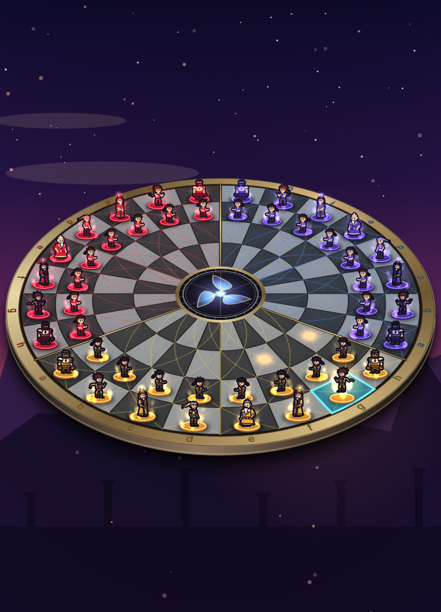

# Règles officielles — Chess Trio Warriors

Ce document est la référence des règles du jeu. Le moteur `engine/` en est l'implémentation
exacte (source de vérité côté serveur).

## 1. Joueurs et ordre de jeu

- Trois joueurs : **0 = Blanc**, **1 = Rouge**, **2 = Noir**.
- Ordre de jeu : 0 → 1 → 2 → 0… Les joueurs éliminés sont sautés.

## 2. Le plateau

### 2.1 Forme

Le plateau est un **disque de 96 cases**, comme les échiquiers circulaires à trois joueurs du
commerce :

- 24 **rayons** découpent le disque en secteurs angulaires de 15° ; 4 **anneaux**
  concentriques en damier entourent un **médaillon central** (≈ 22 % du rayon) qui n'est pas
  une case ;
- chaque joueur possède un arc de **120°** (8 colonnes × 4 rangées = 32 cases) : une colonne
  est un secteur angulaire, une rangée est un anneau (rangée 1 = anneau extérieur, rangée 4
  = anneau qui borde le médaillon) ;
- chaque arc est coupé en deux **moitiés** de 60° : colonnes a-d et colonnes e-h ;
- dans le sens trigonométrique, on trouve le joueur 0 (Blanc, en bas sur le schéma), le
  joueur 2 (Noir, en haut à droite) puis le joueur 1 (Rouge, en haut à gauche) : l'ordre de
  jeu 0 → 1 → 2 tourne dans le sens des aiguilles d'une montre.

```
        (colonnes de la rangée 1, sur l'anneau extérieur ; « ║ » = frontière entre joueurs)

                           1a ║ 2h
                   1b                 2g
             1c        Rouge  ║  Noir      2f
         1d             (1)       (2)          2e
       1e                     ║                  2d
      1f              .---------------.            2c
      1g             (    médaillon    )           2b
       1h             '---------------'           2a
          ═══════  ╱           |           ╲  ═══════
         0a     0b     0c    0d | 0e    0f     0g     0h
                             Blanc (0)
```

Les trois **frontières entre joueurs** (h d'un joueur contre a du suivant) sont marquées par
un filet métallique épais : ces cases sont côte à côte sur le disque mais **ne sont pas
voisines** (c'est le bord du plateau, au sens des règles). Le prolongement de chaque frontière
de l'autre côté du médaillon passe entre les colonnes d et e du troisième joueur.



### 2.2 Coordonnées

Une case s'écrit `<secteur><colonne><rangée>`, vue depuis le **propriétaire du secteur** :

- secteur `0`, `1` ou `2` (le joueur à qui appartient ce secteur) ;
- colonne `a` à `h`, de la gauche vers la droite du propriétaire, assis au bord face au
  centre (sens trigonométrique sur le disque) ;
- rangée `1` à `4`, de son bord (rangée 1, anneau extérieur) vers le centre (rangée 4,
  anneau intérieur).

Exemples : `0e1` est la case de départ du roi Blanc, `2d4` une case centrale du secteur Noir.

Index interne (0..95) : `secteur × 32 + (rangée − 1) × 8 + colonne` (a = 0 … h = 7).

### 2.3 Voisinage et traversée du centre

Dans un secteur, le voisinage est celui d'un échiquier ordinaire. « Avant » signifie « vers
le centre » pour le propriétaire du secteur, « droite » vers la colonne h.

**Franchir la rangée 4** fait entrer dans le secteur voisin, par sa rangée 4 :

| Depuis (secteur s, rangée 4) | Arrivée                               |
|------------------------------|---------------------------------------|
| colonne a, b, c, d           | secteur s−1 (mod 3), colonne h, g, f, e |
| colonne e, f, g, h           | secteur s+1 (mod 3), colonne d, c, b, a |

Exemple : la colonne d de Blanc se prolonge par la colonne e de Noir (`0d1 … 0d4, 2e4 … 2e1`),
la colonne e de Blanc par la colonne d de Rouge. En entrant dans le secteur voisin, le sens
s'inverse : « avant » devient « arrière », « droite » devient « gauche » (rotation de 180°).

Les rangées ne se prolongent pas : au-delà de la colonne a ou h, c'est le bord du plateau.

**Lecture sur le disque.** Franchir la rangée 4, c'est **traverser le médaillon** : on
ressort dans le demi-arc diamétralement opposé (la moitié a-d du joueur s fait face à la
moitié e-h du joueur s−1). L'ordre des colonnes s'y inverse : une colonne du milieu (d/e)
se prolonge par une colonne du milieu, une colonne du bord (a/h) par une colonne du bord.
Géométriquement, c'est une symétrie par rapport au diamètre qui porte la frontière entre les
deux joueurs concernés, et non une symétrie centrale : la case d'arrivée est à 45° (colonnes
a, d, e, h) ou 15° (b, c, f, g) de la case exactement opposée. Une symétrie centrale exacte est
impossible pour les trois paires de moitiés à la fois (elle conserverait le sens de rotation
alors que la règle l'inverse, et trois joueurs donnent un nombre impair de frontières) ; la
convention retenue garde les demi-arcs exactement opposés. Exemple : `0d4` (juste à gauche du
bas du médaillon) mène à `2e4` (au milieu de l'arc Noir).

**Diagonales.** Un pas en diagonale est la composition d'un pas avant/arrière et d'un pas
gauche/droite. Partout sur le plateau, les deux ordres possibles mènent à la même case, **sauf
au centre**, où 6 cases se touchent au lieu de 4 : la diagonale qui passe par le point central
**se dédouble**. Depuis une case centrale, la diagonale « avant-intérieure » mène aux deux cases
centrales situées à deux crans autour du point central. Exemple : depuis `0d4`, la diagonale
avant-droite mène à `1d4` **et** à `2d4` (mais pas à `1e4`, la case « opposée »). Ainsi la
grande diagonale `0a1-0b2-0c3-0d4` se prolonge à la fois par `1d4-1c3-1b2-1a1` et par
`2d4-2c3-2b2-2a1`.

Conséquences : une case centrale (d4/e4) a 9 voisines au lieu de 8 ; un fou, une dame ou un
pion peuvent avoir deux trajectoires après le centre.

## 3. Position initiale

Chaque joueur, dans son secteur : rangée 1 = T C F D R F C T (de a à h, dame en d1, roi en
e1), rangée 2 = 8 pions. La position est identique pour les trois joueurs (symétrie de
rotation).

## 4. Déplacement des pièces

Les mouvements sont ceux des échecs classiques, appliqués à la topologie ci-dessus :

- **Tour** : en ligne droite (avant/arrière/gauche/droite), autant de cases que voulu, sans
  sauter de pièce ; une colonne se poursuit dans le secteur d'en face (2.3).
- **Fou** : en diagonale, idem ; au centre la trajectoire se dédouble (les deux branches sont
  possibles, chacune bloquée indépendamment).
- **Dame** : tour + fou.
- **Roi** : une case dans n'importe laquelle des directions (y compris les deux cases d'une
  diagonale dédoublée).
- **Cavalier** : deux pas orthogonaux dans une direction puis un pas perpendiculaire, les pas
  pouvant être faits dans n'importe quel ordre (2-1, 1-2 ou pas intercalé) ; il saute par-dessus
  les pièces. La case d'arrivée n'est jamais voisine de la case de départ. Près du centre, les
  différents ordres peuvent mener à des cases différentes : toutes sont autorisées.
- **Pion** : avance d'une case vers l'avant (vers le centre tant qu'il est dans son secteur ;
  une fois entré dans un autre secteur, vers la rangée 1 de ce secteur). Depuis sa rangée 2 de
  départ, il peut avancer de deux cases si les deux sont libres. Il prend en diagonale vers
  l'avant (diagonales dédoublées comprises).
  - **Promotion** : un pion qui atteint la rangée 1 d'un adversaire est automatiquement
    promu en **dame**.
  - **Pas de prise en passant.**
- **Roque** (petit : roi e1→g1 et tour h1→f1 ; grand : roi e1→c1 et tour a1→d1) aux
  conditions classiques : ni le roi ni la tour concernée n'ont bougé (un droit est perdu dès
  que la pièce quitte sa case ou que la tour y est prise), les cases entre eux sont vides, le
  roi n'est pas en échec, et ni la case traversée ni la case d'arrivée du roi ne sont
  attaquées par **un quelconque adversaire actif**.

Le coup est désigné par sa case de départ et d'arrivée (pour le roque : celles du roi).

## 5. Échec, mat et pat

- Un roi est **en échec** s'il est attaqué par une pièce d'un adversaire **actif**.
- Un coup est **illégal** s'il laisse le roi de celui qui joue attaqué par une pièce active
  de n'importe quel adversaire.
- Un roi actif ne peut jamais être pris : s'il se trouve attaqué par le joueur au trait (par
  exemple après une attaque à la découverte provoquée par le troisième joueur), il reste
  simplement en échec, et son propriétaire devra parer à son tour.
- **Au début du tour d'un joueur actif** :
  - s'il n'a aucun coup légal et qu'il est en échec → il est **mat** ;
  - s'il n'a aucun coup légal sans être en échec → il est **pat** : il **passe son tour**
    (il n'est pas éliminé et rejouera dès qu'il aura un coup légal). Si tous les joueurs
    actifs sont pats l'un après l'autre, la partie est nulle.
- **Crédit du mat** : le mat est crédité à l'adversaire qui attaque le roi ; si les deux
  adversaires l'attaquent, il est crédité à celui des deux qui a joué le plus récemment.

## 6. Modes de fin de partie

- **`firstMate`** : la partie s'arrête au premier mat ; le vainqueur est le joueur crédité du
  mat.
- **`twoMates`** : le joueur mat est **éliminé** ; la partie continue entre les deux autres ;
  le dernier joueur restant gagne.

## 7. Pièces d'un joueur éliminé (gelées)

Les pièces d'un joueur éliminé (mat en mode `twoMates`, ou abandon) **restent sur le
plateau, gelées** :

- elles ne bougent plus ;
- elles ne donnent jamais échec et n'attaquent aucune case (y compris pour le roque) ;
- elles bloquent les lignes comme n'importe quelle pièce ;
- elles peuvent être prises par les joueurs actifs, **roi gelé compris** (la prise du roi
  gelé n'a aucun effet particulier).

## 8. Abandon, déconnexion, temps

- **Abandon / déconnexion** : le joueur est éliminé comme s'il était mat, **sans crédit**
  pour personne ; ses pièces sont gelées. S'il ne reste qu'un joueur actif, celui-ci gagne.
  - **Choix en mode `firstMate`** : un abandon ne termine pas la partie (personne n'a fait
    mat). La partie continue à deux joueurs et s'arrête au **mat suivant**, gagné par celui qui
    le donne (ou par le joueur restant si l'autre abandonne aussi).
- **Temps écoulé** : quand un joueur dépasse son temps de réflexion (60 s, géré par le
  serveur), un **coup légal tiré au hasard** est joué à sa place.

## 9. Parties nulles

- **Règle des 50 coups** : la partie est nulle après **50 tours complets** sans prise ni
  mouvement de pion. Un tour complet = un tour de chaque joueur actif ; le seuil est donc de
  50 × (nombre de joueurs actifs) tours individuels consécutifs (150 à trois, 100 à deux). Un
  tour passé pour cause de pat compte comme un tour.
- **Triple répétition** : la partie est nulle quand la même position se présente pour la
  troisième fois (même placement des pièces, même joueur au trait, mêmes joueurs actifs, mêmes
  droits de roque).
- Plus aucun joueur actif ne peut jouer (tous pats) : nulle.

Il n'y a pas de nulle automatique par matériel insuffisant.

## 10. Interface du moteur (`engine/src/index.ts`)

État immuable, entièrement sérialisable en JSON (`GameState`).

| Fonction | Rôle |
|----------|------|
| `initialState(mode)` | nouvelle partie (`'firstMate'` ou `'twoMates'`) |
| `legalMoves(state)` | coups légaux du joueur au trait (`{ from, to, castle?, promotion?, capture? }`) |
| `applyMove(state, move)` | nouvel état ; lève une erreur si le coup est illégal |
| `randomMove(state, rng?)` | coup légal aléatoire (timeout), `rng` injectable |
| `resign(state, player)` | abandon / déconnexion |
| `botMove(state, level, { rng?, maxNodes? })` | coup d'un bot : `facile` (aléatoire, prend une pièce gratuite une fois sur deux), `moyen` (1 coup + menaces des 2 adversaires), `difficile` (recherche paranoïaque alpha-bêta profondeur 3, quiescence, budget de nœuds) |
| `status(state)` | trait, échecs en cours, joueurs actifs, éliminations, résultat |
| `boardCells()` | géométrie de rendu des 96 cases (centre + 4 sommets) |
| `customState(mode, pieces, opts)` | position arbitraire (tests, puzzles) |

`state.lastEvent` décrit le dernier évènement (pour animations et voix) : pièce déplacée,
pièce prise (type, propriétaire, gelée ou non), promotion, roque (avec le trajet de la tour),
échecs en cours après le coup (`checks` : joueur attaqué + attaquants), mats constatés
(`mates`), éliminations, passes pour pat, fin de partie (`gameOver`).

### Géométrie

`roundBoardCells()` (et le fichier `engine/geometry.json`, copié dans
`app/assets/geometry.json`, produit par `npm run export-geometry`) donne la géométrie du
**plateau rond**, pour chaque case : `id`, `index`, `sector`, `file`, `rank`, `ring`
(= rangée, 1 = anneau extérieur), `wedge` (secteur angulaire 0..23), `angle`, `a0`, `a1`
(degrés), `r0`, `r1` (rayons), centre `x, y`, `polygon` (secteur annulaire : 8 points sur
l'arc extérieur puis 8 sur l'arc intérieur) et `light` (damier). Le fichier donne aussi
`rings` (rayons des 5 cercles), `medallion` et `outline` (contour du disque).

Repère normalisé : x vers la droite, **y vers le bas**, disque de centre (0,5 ; 0,5) et de
rayon 0,5 ; angles en degrés dans le sens trigonométrique vu à l'écran
(x = 0,5 + r cos a, y = 0,5 − r sin a). Blanc (0) occupe l'arc 210°–330° (en bas), Noir (2)
330°–90° (en haut à droite), Rouge (1) 90°–210° (en haut à gauche) ; une rotation de −120°
fait passer du secteur p au secteur p+1. Le client fait pivoter l'ensemble de viewer × 120°
pour placer le joueur local en bas, puis applique une perspective (ellipse écrasée ≈ 0,62).
L'ancienne géométrie hexagonale reste disponible (`boardCells()`), avec la même topologie.
